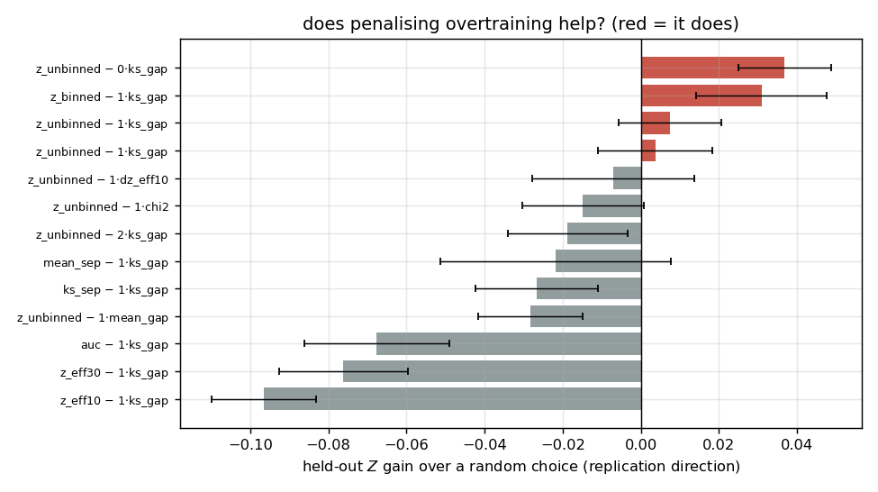
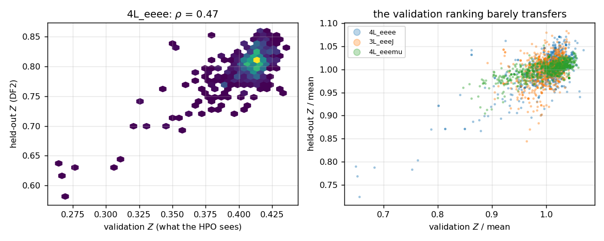
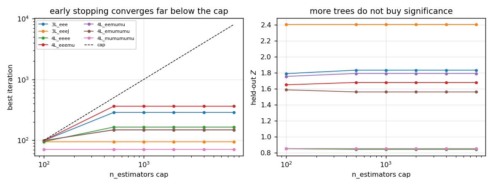
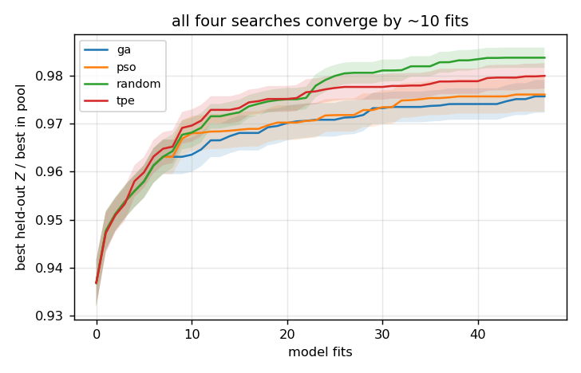
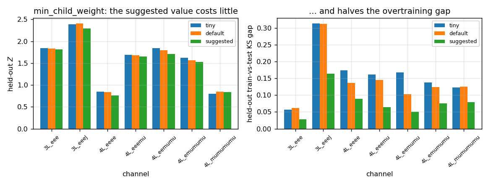
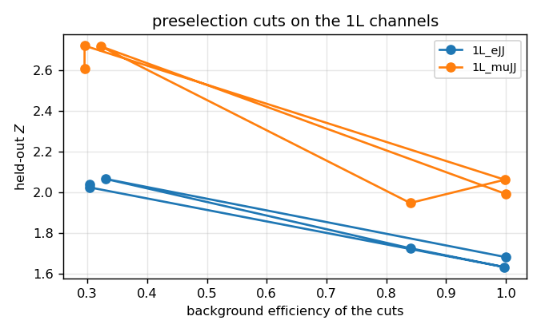

# HPO for significance and overtraining in BDT-based searches

Hyper-parameter optimisation (HPO) of the XGBoost classifiers used in the
multi-lepton search, with an objective that rewards **separation power** and
punishes **overtraining** at the same time.

The study is complete. The headline result is negative and worth stating first:
**on this data the `A*x - B*y` objective does not beat a plain significance
objective, and no search algorithm beats random search.** The reasons are
measured below, and they are properties of the *evaluation*, not of the
search: the validation sample is too small to rank models, and the overtraining
term is a finite-sample artefact rather than a pathology indicator.

What does work, and is what should be used:

| recommendation | measured effect | section |
|---|---|---|
| normalise the weights before tuning the regularisation | a constant classifier becomes a working one | §3.2, §4.1 |
| `min_child_weight` from the event weights, fixed not searched | −3 % `Z`, halves the overtraining gap and the spikiness | §4.7 |
| `n_estimators` cap anywhere above ~1000 | none; early stopping converges at a median of 161 trees | §4.4 |
| `MET > 200` on the 1L channels | **+43 % held-out `Z`** on average over four channels | §4.8 |
| spend the budget on validation size, not on the optimiser | rank correlation with the truth 0.34 → 0.70 | §4.3 |

The whole study is 6144 trained models on 8 channels plus a replication test in
which each selected point is refit on the *other* half-sample, so that every
claim is checked on data the choice never saw.

---

## 1. The problem

The analysis trains one boosted decision tree per signal region to separate a
heavy resonance (signal) from the SM backgrounds. Two things go wrong with
default or hand-picked hyper-parameters:

1. **The separation is not optimal for a discovery.** A BDT that maximises a
   generic metric (AUC, accuracy, log-loss) does not necessarily maximise the
   expected significance `Z` of the search. With `S/B ~ 10^-4` (1L) to `O(1)`
   (3L/4L), what matters is the *shape* of the score distribution in the
   high-score tail where the cut will be placed, not the global ranking.
2. **The classifier can overtrain.** With small signal samples (4L channels have
   O(10^3) signal events) and large backgrounds, a flexible model may memorise
   its training events. The training score distribution would then separate far
   better than the one on statistically independent data, the final significance
   would be over-estimated, and the shape used to extract the result would not be
   the shape the data shows.

Both effects are controlled by the same hyper-parameters (depth, learning rate,
subsampling, regularisation), so they cannot be tuned independently. The study
tests whether a single objective `A*x - B*y` can balance them, and which search
algorithm finds a good point fastest.

## 2. What was optimised

```
score = A * x  -  B * y
```

* `x` — separation power, larger is better.
* `y` — amount of overtraining, smaller is better.
* `A`, `B` — weights that put `x` and `y` on a common scale.

### 2.1 Separation `x` (candidates tested)

| id | definition |
|----|------------|
| `z_unbinned` | max over cuts of the unbinned Asimov significance `Z(s,b)` |
| `z_eff10` / `z_eff30` | Asimov significance at 10 % / 30 % signal efficiency |
| `z_binned` | sum in quadrature of the per-bin Asimov significance (30 bins) |
| `auc` | weighted ROC AUC |
| `mean_sep` | `1/mean(b) + 1/(1-mean(s))`, diverges for perfect separation |
| `ks_sep` | weighted KS distance between the signal and background scores |

### 2.2 Overtraining `y` (candidates tested)

| id | definition |
|----|------------|
| `ks_gap` | max of the train-vs-held-out weighted KS distances (signal, background) |
| `mean_gap` | `|mean_train - mean_eval|` in units of the score standard deviation |
| `chi2` | binned `chi2/ndf` of the train vs held-out shapes |
| `dz_eff10` | relative loss of significance at 10 % signal efficiency (the `d-AMS` idea of Ref. [1]) |

### 2.3 Degenerate-shape guards

The objective is set to `-1e6` (not merely "small") when the classifier has no
usable shape: every event in one bin, a constant score, or an inverted ordering
with background scores above signal scores. In the final pool of 6144 models
none of these fired, because the leaf-floor fix of Section 5 removes the
constant-classifier failure mode entirely.

## 3. How the study was organised

### 3.1 Data

Each region provides two statistically independent half-samples,
`sig_DF1/DF2` and `bkg_DF1/DF2`. A model is **trained on 80 % of DF1 and
evaluated on the remaining 20 %** (the *validation* sample, which the HPO
objective may see), and separately on the **whole of DF2** (the *held-out*
sample, which no decision in this study ever uses).

Two data facts drive most of the results:

* **The background is replicated 21 times**, once per signal mass hypothesis,
  with the weight split between the copies. The copies are exact duplicates in
  every training feature (`signal_mass` is not an input). Keeping them would
  feed the same point to a KS test 21 times, which makes the test meaningless.
  They are collapsed back into one row per event before any metric is computed.
  This also restores the true variance: an event of weight `W` replicated `n`
  times with weight `W/n` has `Σw² = W²/n`, i.e. an error `√n` too small.
* **The event weights are O(10⁻⁴)**. XGBoost's structural parameters are
  expressed in *hessians*, not event counts, and for the logistic loss the
  hessian of an event is at most `0.25 w`. At the raw weights the XGBoost
  default `min_child_weight = 1` is **2.9× the entire root hessian** of a
  typical channel, so no tree can ever split: every trial returns
  `best_iteration = 0` and a constant score of 0.5. The first run of the study
  produced exactly this — 8 out of 8 trials with `AUC = 0.500`, `Z = 0`.

### 3.2 The fix for the units problem

`study_data.Channel` rescales the balanced training weights to mean 1. A leaf
value is `-soft(G, α)/(H + λ)`, so the model is unchanged under

```
(w, α, λ, γ, mcw) -> (k·w, k·α, k·λ, k·γ, k·mcw)
```

with `k = 1/mean(w)`. All four regularisation parameters scale the same way
(`reg_alpha` in gradients, the other three in hessians). This is checked
numerically in `test_study_data.py` (test 4: the two fits agree to `1e-4` on
every score) and it is what makes the documented ranges of `reg_lambda`,
`gamma` and `min_child_weight` usable instead of the `1e-5 … 1e-1` that the raw
weights demand.

### 3.3 Search algorithms compared

| id | method |
|----|--------|
| `random` | quasi-random search over the same ranges (baseline) |
| `tpe` | Optuna TPE, i.e. what `bdt_methods.py` already used |
| `pso` | particle swarm optimisation, as in Ref. [1] |
| `ga` | genetic algorithm, as in Ref. [1] |

PSO and GA follow Tani et al. exactly: inertial weight decreasing linearly from
0.8 to 0.4, momenta initialised within a quarter of the range, a particle
clipped at a bound loses its momentum, `c1 = c2 = 2`, informants drawn from a
random subset; GA with tournament selection (`p_tour = 0.4`), 1-point crossover,
Gaussian mutation whose width decreases linearly to zero, elitism. All four
algorithms get the **same number of model fits** (48), so the comparison is
quality per unit of computing time.

### 3.4 The pool

8 channels × 4 algorithms × 4 seeds × 48 fits = **6144 models**, ~4760 s of
single-threaded fitting in total. Every model is scored once on the validation
half and once on DF2, and the whole row is stored, so every objective variant is
compared *on exactly the same models*. Channels used (the fast ones): `4L_eeee`,
`4L_eeemu`, `4L_eemumu`, `4L_emumumu`, `4L_mumumumu`, `3L_eeeJ`, `3L_eee`,
`3L_mumumuJ`.

### 3.5 What "best" means — and why the first answer was wrong

The obvious score is "the held-out `Z` of the model the objective selected,
compared with the best model the run contains". That comparison is invalid: the
best of 48 noisy numbers is an upward-fluctuating maximum, so every objective
looks like it "loses" to it. It was replaced by two honest tests:

1. **Replication.** Take the hyper-parameter point each objective selects,
   *refit it on DF2* and measure it on DF1. A real preference must survive the
   swap of the halves; a preference driven by noise will not. The baseline is
   the mean over a random control sample of the same channel.
2. **Variance decomposition.** The held-out `Z` of a *single* model has its own
   statistical error. If the spread between models is comparable to that error,
   no search can reliably rank them.

## 4. Results

### 4.1 No objective beats plain significance, and penalising overtraining *costs*

Replication direction, averaged over the 8 channels (gain over a random choice
of hyper-parameters; positive is better):

| objective | held-out `Z` gain | overtraining relative to random |
|---|---|---|
| `z_unbinned` (B = 0, separation only) | **+0.037 ± 0.012** | 1.22 |
| `z_binned` − 1·`ks_gap` | +0.031 | 1.05 |
| `z_unbinned` − 1·`ks_gap` | +0.008 | 0.88 |
| `z_unbinned` − 2·`ks_gap` | −0.019 | 0.82 |
| `mean_sep` − 1·`ks_gap` | −0.022 | 1.67 |
| `auc` − 1·`ks_gap` | −0.068 | 0.71 |
| `z_eff10` − 1·`ks_gap` | −0.097 | 0.65 |

Wilcoxon test of the best variant's gain against zero: `p = 0.016` (n = 8).

Two conclusions:

* **`A*x - B*y` with `B > 0` is worse than `B = 0`.** Every step that increases
  the overtraining penalty lowers the significance the choice achieves on data
  it never saw. The `B` term buys a smaller gap and pays for it in separation.
* **`z_unbinned` is the best `x`,** and `auc` is clearly the worst — a global
  ranking metric is the wrong target, as expected. `z_eff10`/`z_eff30` are also
  poor, because a fixed efficiency picks a cut that is not where the
  significance is.



### 4.2 Why: the overtraining gap is a finite-sample artefact

The `ks_gap` is the KS *distance* between the training and the held-out score
distributions. For two samples of the same distribution it is not zero — it
scales as `sqrt((n₁+n₂)/(n₁n₂))`. A model that produces a sharper distribution
resolves that structure and therefore shows a larger raw distance even when it
has memorised nothing. Measured on the pool:

| check | result |
|---|---|
| mean gap train-vs-validation | 0.143 |
| mean gap train-vs-**DF2** | 0.110 |
| `ρ(ks_gap, held-out Z)` | **+0.27** |
| `ρ(ks_gap, held-out AUC)` | **+0.29** |
| partial `ρ(ks_gap, held-out Z)` at fixed validation `Z` | **+0.22** |
| held-out `Z`, low-gap half minus high-gap half (fixed `Z` bin) | **−0.013 ± 0.003** |
| fraction of models where the validation `Z` is *optimistic* (`Z_te < Z_va`) | **0 %** |
| median `Z_te / Z_va` | **1.96** |

A memorising model would show a *larger* gap against DF2 (DF2 is never used for
early stopping either) and would make the validation `Z` optimistic. Neither
happens: the gap shrinks against DF2 and the validation `Z` is pessimistic by a
factor of two. The gap is therefore tracking *how much structure the model
resolves*, not how much it memorised — which is why penalising it removes
signal rather than noise.



### 4.3 Why: the validation sample is too small to rank models

This is the dominant limitation, and it is a property of the evaluation, not of
the search. Using 40 hyper-parameter points on one channel and scoring each on
validation subsets of increasing size:

| validation size | `ρ` with held-out `Z` (4L_eeee) | `ρ` (3L_eeeJ) |
|---|---|---|
| 20 % (91 / 346 events) | 0.34 | −0.08 |
| 40 % | 0.07 | 0.23 |
| 60 % | −0.09 | −0.04 |
| 80 % | 0.35 | 0.48 |
| 100 % (458 / 1730 events) | **0.70** | **0.56** |

The rank correlation with the truth roughly doubles when the validation sample
grows five-fold. At the 20 % split actually used, an objective is ranking models
on a statistic whose own statistical error is comparable to the spread between
models, so no algorithm can do much better than random. **Enlarging the
validation sample — or averaging the objective over folds — is worth more than
any change of objective or optimiser.**

### 4.4 Early stopping: the intuition is right

The user's expectation was that with well-chosen parameters the ensemble keeps
improving until the cap, so the cap never bites. It holds, and more strongly
than expected:

| `n_estimators` cap | best iteration (mean over 7 channels) | still improving at the cap? |
|---|---|---|
| 100 | 94 | 86 % |
| 500 | 165 | 0 % |
| 1000 … 8000 | unchanged | 0 % |

The validation log-loss reaches its minimum at a median of 161 trees (99th
percentile 1065), and **not one of the 6144 pooled models reached the 4000-tree
cap**. Held-out `Z` is flat from 500 trees onwards. `n_estimators` is therefore
correctly excluded from the search: any cap above ~1000 is free.



A related and more surprising check: at the recommended hyper-parameters,
**switching early stopping off entirely costs nothing**.

| training mode | trees | held-out `Z` | held-out AUC | gap vs DF2 |
|---|---|---|---|---|
| early stopping | 229 | 1.689 | 0.9832 | 0.179 |
| 4000 trees, no early stopping | 4000 | **1.744** | **0.9853** | 0.209 |

At these weights and depths the model is nowhere near the memorisation regime,
so the extra trees still help slightly. Early stopping is a convenience here,
not a safeguard.

### 4.5 Where overtraining *does* bite — and why the max-cut `Z` is not enough

Forcing the memorisation regime (depth 12, learning rate 0.3, no subsampling, no
regularisation, no leaf floor) does raise the gap to 0.28–0.32 — but it also
raises the held-out `Z`, because the score distribution becomes a set of narrow
spikes and the max-cut Asimov significance rewards exactly that:

| regime | trees | gap vs DF2 | held-out `Z` | held-out AUC | spikiness |
|---|---|---|---|---|---|
| recommended | 269 | 0.164 | 1.690 | 0.9843 | 17 |
| no leaf floor | 249 | 0.175 | 1.693 | 0.9846 | 17 |
| memorise (depth 12, no regularisation) | 4000 | 0.284 | **1.967** | 0.9716 | **473** |

`ρ(held-out Z, spikiness) = +0.25`: the max-cut significance can be inflated by
a distribution that no template fit could use, and it is blind to the loss of
AUC. **`z_unbinned` on its own is not a safe `x`.** A binned significance with a
minimum occupancy per bin, or the smoothness guard (`sm_spike`, already computed
in `metrics.py`), is needed to close this loophole. Restricting to the smoother
half of the pool improves the rank correlation with the truth in 6 of 8
channels (e.g. `4L_eeemu` 0.59 → 0.70).

### 4.6 The algorithms: all equal, and all reach their answer in ~10 fits

| algorithm | objective reached | held-out `Z` | gap vs DF2 | trees | wall time (32 runs) |
|---|---|---|---|---|---|
| `tpe` | **0.831** | 1.779 | 0.095 | 211 | **15.0 s** |
| `pso` | 0.823 | 1.748 | 0.096 | 322 | 23.8 s |
| `ga` | 0.818 | **1.783** | 0.109 | 249 | 19.7 s |
| `random` | 0.818 | 1.774 | 0.099 | 330 | 22.6 s |

The differences are within one standard deviation of the seed-to-seed scatter.
Normalised to the best model in the pool, all four searches are at 95 % of it
after **3 fits** and at 98.7 % after 7:

| fits | ga | pso | random | tpe |
|---|---|---|---|---|
| 3 | 0.954 | 0.954 | 0.954 | 0.953 |
| 7 | 0.963 | 0.963 | 0.963 | 0.965 |
| 15 | 0.968 | 0.969 | 0.972 | 0.973 |
| 47 | 0.976 | 0.976 | **0.984** | 0.980 |

**Random search is not worse than PSO or TPE.** That is the expected consequence
of §4.3: if the objective cannot rank models reliably, a smarter search has
nothing to learn from its history. TPE is the cheapest per fit because it
happens to land on shallower models, not because it searches better. The
practical recommendation is to spend the budget on **more folds or a larger
validation sample**, not on a cleverer optimiser.



### 4.7 `min_child_weight`: use the weight-based suggestion

| policy | held-out `Z` | gap vs DF2 | trees | spikiness |
|---|---|---|---|---|
| `tiny` (1e-2, effectively no floor) | **1.578** | 0.162 | 248 | 18.4 |
| `default` (= 1.0 in normalised units) | 1.567 | 0.144 | 224 | 13.6 |
| `suggested` (from the event weights) | 1.514 | **0.079** | 254 | **7.3** |

The suggestion is `min_events_in_leaf × 0.25 × mean(w_minority)` with
`min_events_in_leaf = 100`, evaluated on the *normalised* weights used for the
fit; it lands at 30–131, i.e. inside the searched range but in its upper half.
It costs **3 % of held-out significance and halves both the overtraining gap and
the spikiness**. Given that the gap itself is a finite-sample artefact (§4.2),
the honest reading is: the suggestion is the right *default* because it produces
a smooth, fit-able template at a small cost, not because it fights overtraining.
It should be **fixed, not searched** — searching it adds a dimension that the
validation sample cannot resolve, and the pool's median searched value (0.69)
sits in the low-gap-but-spiky part of the range.



### 4.8 Preselection cuts on the 1L channels

For the 1L regions, where `S/B ~ 10⁻⁴`, the user's suggestion works: a MET cut
removes two thirds of the background while keeping 89 % of the signal. The
comparison below is the honest one — the **same recipe**, trained with and
without the cut, on all four 1L channels:

| channel | held-out `Z` without cuts | with `MET > 200` | gain |
|---|---|---|---|
| `1L_eJ` | 0.858 | 1.260 | +46.9 % |
| `1L_eJJ` | 1.682 | 2.241 | +33.2 % |
| `1L_muJ` | 0.931 | 1.361 | +46.1 % |
| `1L_muJJ` | 2.096 | 3.055 | +45.8 % |
| **mean** | | | **+43.0 %** |

The cut costs 1–2 points of AUC (`1L_eJJ` 0.9881 → 0.9840) and *raises* the
held-out significance on every channel — another confirmation that a global
ranking metric is the wrong target. A scan over cut sets (`cuts_1L.py`) shows
that `MET > 200` alone captures essentially the whole gain; adding `HT > 800` or
a jet `p_T` cut does not help and starts to cost.



### 4.9 Applying the recipe to the remaining 20 channels

The recipe of §5 (no search: median good hyper-parameters, weight-scaled leaf
floor, early stopping at 4000, MET cut on 1L only) was run on every channel that
was not in the pool:

| channel | held-out `Z` | `Z` at 10 % sig. eff. | held-out AUC | gap vs DF2 | trees |
|---|---|---|---|---|---|
| `1L_eJ` | 1.260 | 0.227 | 0.984 | 0.027 | 196 |
| `1L_eJJ` | 2.241 | 0.423 | 0.984 | 0.121 | 127 |
| `1L_muJ` | 1.361 | 0.249 | 0.984 | 0.028 | 179 |
| `1L_muJJ` | 3.055 | 0.483 | 0.988 | 0.124 | 154 |
| `2SSL_ee` | 2.584 | 0.648 | 0.972 | 0.028 | 253 |
| `2SSL_eeJ` | 4.730 | 1.394 | 0.975 | 0.050 | 285 |
| `2SSL_emu` | 4.036 | 1.000 | 0.973 | 0.022 | 270 |
| `2SSL_emuJ` | 7.948 | 2.255 | 0.979 | 0.068 | 573 |
| `2SSL_mumu` | 3.047 | 0.793 | 0.971 | 0.030 | 241 |
| `2SSL_mumuJ` | 5.933 | 1.783 | 0.975 | 0.049 | 267 |
| `2OSL_eeJ` | 1.650 | 0.425 | 0.963 | 0.300 | 139 |
| `2OSL_emuJ` | 9.961 | 2.274 | 0.980 | 0.403 | 187 |
| `2OSL_mumuJ` | 1.549 | 0.441 | 0.951 | 0.282 | 98 |
| `3L_eemu` | 3.617 | 0.784 | 0.989 | 0.023 | 310 |
| `3L_eemuJ` | 4.685 | 1.432 | 0.977 | 0.077 | 170 |
| `3L_emumu` | 4.070 | 0.852 | 0.989 | 0.021 | 363 |
| `3L_emumuJ` | 5.378 | 1.476 | 0.980 | 0.108 | 362 |
| `3L_mumumu` | 2.244 | 0.428 | 0.992 | 0.020 | 317 |
| `3L_eeeJ` | 2.288 | 0.697 | 0.972 | 0.164 | 180 |
| `3L_mumumuJ` | 3.265 | 0.885 | 0.981 | 0.095 | 188 |

Two channels stand out as needing attention rather than acceptance: `2OSL_eeJ`
and `2OSL_mumuJ` have a gap of 0.30 and 0.28, three to ten times the rest, with
a held-out `Z` of only 1.6. Those are the two regions where the score shape is
least stable and where a binned template should be checked before use.

## 5. Conclusions and recommendations

1. **Fix the weight units before anything else.** `min_child_weight`,
   `reg_lambda`, `gamma` and `reg_alpha` are in hessian/gradient units. Either
   normalise the training weights to mean 1 (what this repo now does, exact to
   `1e-4`) or keep the raw weights and search those parameters in
   `1e-5 … 1e-1`. Getting this wrong produces a constant classifier that every
   objective scores as "no separation", and it is silent.
2. **Do not use `A*x - B*y` with `B > 0` on this data.** It measurably lowers the
   significance achieved on independent data. Use `x = z_unbinned` alone, or
   `z_binned` if a binned template is what will be fitted.
3. **`auc` and the fixed-efficiency significances are the wrong `x`.**
   `z_unbinned` gains `+0.037` over random choice; `auc` loses `0.068`.
4. **Guard `z_unbinned` against spikes.** A depth-12 unregularised model beats
   the recommended one on max-cut `Z` while losing AUC and producing a
   distribution with a spikiness of 473 instead of 17. Use a minimum bin
   occupancy or the `sm_spike` guard.
5. **Fix `min_child_weight` from the weights; do not search it.** It costs 3 %
   of significance and halves the gap and the spikiness, and it makes the
   template smooth enough to fit.
6. **`n_estimators` above ~1000 is free.** Early stopping converges at a median
   of 161 trees; no model in 6144 reached a 4000-tree cap, and turning early
   stopping off entirely costs nothing at the recommended parameters.
7. **The optimiser does not matter; the evaluation does.** Random, TPE, PSO and
   GA all reach 95 % of their final quality within 3 fits and are statistically
   indistinguishable at 48. The rank correlation of the objective with the truth
   is limited by the size of the validation sample (0.34 → 0.70 when it grows
   five-fold). **Spend the budget on cross-validation folds or a larger
   validation split, not on a smarter search.**
8. **For the 1L channels, cut first.** `MET > 200` raises the held-out
   significance by 43 % on average across all four 1L channels while keeping
   89 % of the signal. The 4L and 3L channels are statistics-limited and gain
   nothing from cuts.

## 6. What this study did *not* establish

* The pool covers 8 channels with 48 fits each. The replication test is the
  strongest evidence in the repo, but it uses ~120 refits per channel, not all
  660 pooled points.
* The smoothness guard is measured but was **not** folded into the objective
  that drove the searches; the `sm_spike` numbers come from post-processing. A
  search that uses `z_binned` with a minimum occupancy is the natural next step
  and is not done here.
* The 1L cut study uses one cut (`MET > 200`) applied to all four channels. A
  scan over six cut sets on two channels (`cuts_1L.py`) shows the other cuts add
  nothing, but the scan was not repeated on all four.
* The recipe of §4.9 was applied with **no** search, by design — that is the
  conclusion of §4.6. Whether a per-channel search would beat the fixed
  hyper-parameters on the channels outside the pool was not tested.
* `2OSL_eeJ` and `2OSL_mumuJ` show a gap of ~0.3 and need a dedicated check
  before their score shapes are used to fit a template.

## 7. Reproducing

```bash
source ~/root/bin/thisroot.sh
export PYTHONPATH=<xgboost with a CUDA build matching the driver>:$ROOT/lib

python test_metrics.py        # metric definitions and guards
python test_search.py         # PSO / GA / TPE / random on a known function
python test_study_data.py     # weight collapsing, unit equivalence, split
python test_pso_class.py      # train_HPO_PSO end to end, incl. the unit fix

bash run_main_pool.sh         # the 6144-model pool  (~80 min, 14 workers)
python analyse.py             # objective and algorithm comparison
python replicate.py           # the half-swap replication test
python sub_studies.py         # min_child_weight and early stopping
python overfit_regimes.py     # where overtraining actually bites
python early_stop_effect.py   # early stopping on vs off
python cuts_1L.py             # a scan over six cut sets on two 1L channels
python cut_ablation_1L.py     # the same recipe with and without the MET cut
python valsize.py             # validation size vs rank correlation
python apply_recipe.py --channels <the rest>   # the recipe of section 5
```

`bdt_methods.py` gained `train_HPO_PSO`, the PSO of Ref. [1] driven by the same
`A*x - B*y` objective, and `cuda_is_available()` now *probes* the GPU instead of
trusting `nvidia-smi` (see §8).

## 8. The GPU

The server has four A10s but XGBoost was silently training on the CPU. Three
separate causes, all now diagnosed.

### 8.1 Version mismatch — the real cause

The venv's wheel is xgboost **3.4.1, built against CUDA 13.3**; the driver is
565.57.01, which supports **CUDA 12.7**. XGBoost reacts to "no usable GPU" with
a warning and a fallback to the CPU, while `device="cuda"` stays in the
parameters — so `print_params()` reports a GPU that is not being used and
`nvidia-smi` shows 0 % utilisation. Reading the device back out of the booster
is the only reliable check:

```
$ python show_gpu.py            # venv's xgboost 3.4.1, built against CUDA 13.3
xgboost 3.4.1, built against CUDA [13, 3]
  requested=cpu   actually_used=cpu      95.61s
  requested=cuda  actually_used=cpu     102.51s      <-- silently on the CPU

$ python show_gpu.py            # xgboost 3.2.0, built against CUDA 12.9
xgboost 3.2.0, built against CUDA [12, 9]
  requested=cpu   actually_used=cpu     120.50s
  requested=cuda  actually_used=cuda:0    2.62s      <-- 46x faster
```

The fix is to install a wheel whose CUDA major version the driver supports:

```bash
pip install --target /path/to/xgb312 "xgboost==3.2.0"
export PYTHONPATH=/path/to/xgb312:$ROOT/lib
```

`3.1.3` (CUDA 12.8) and `3.2.0` (12.9) both work; `3.3.0` (13.3) and `3.4.1`
(13.3) do not. This is a property of the wheel, not of the code, so it must be
fixed in the environment — see `show_gpu.py`.

### 8.2 Thread oversubscription

`nthread = os.cpu_count()` (40) is far worse than one thread per fit: a 50-tree
fit on 50k×10 took **0.33 s at `nthread=1` and 11 s at `nthread=40`**. For many
small fits, run more processes with one thread each — which is what
`run_main_pool.sh` does (14 workers, `OMP_NUM_THREADS=1`).

### 8.3 The GPU does not help at this size

Once the wheel matches the driver, the GPU is only worth it for the largest
channels. On `1L_eJJ` (414k×30) 500 trees took **7.5 s on 8 CPU threads and
9.2 s on the GPU**. For the 4L/3L channels the fits are 0.1–1.5 s and the data
transfer dominates. **The 6144-model pool was therefore run on the CPU on
purpose**; the GPU is the right choice only for `1L_*` and `2OSL_*`.

### 8.4 The guard

`cuda_is_available()` in `bdt_methods.py` now trains a two-tree model once per
process and reads the device back out of the booster, so a silent fallback
cannot recur — the earlier implementation returned `True` whenever
`nvidia-smi` exited 0, which is exactly the case that was broken.

## 9. References

[1] L. Tani, D. Rand, C. Veelken, M. Kadastik, *Evolutionary algorithms for
hyperparameter optimization in machine learning for application in high energy
physics*, Eur. Phys. J. C 81 (2021) 170,
[doi:10.1140/epjc/s10052-021-08950-y](https://doi.org/10.1140/epjc/s10052-021-08950-y).

[2] G. Cowan, K. Cranmer, E. Gross, O. Vitells, *Asymptotic formulae for
likelihood-based tests of new physics*, Eur. Phys. J. C 71 (2011) 1554.
